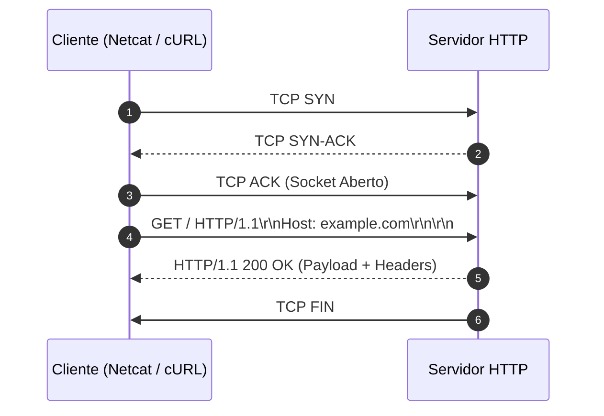

# Memória de Desenvolvimento — Semana 01: Protocolo HTTP & Sockets Bare-Metal
**Aluno:** Rodrigo De Souza Marques   
**Curso:** Bacharelado de Sistemas de Informação

---

## 1. Mapeamento da Camada de Transporte
Diagrama Mermaid demonstrando o ciclo de vida da requisição executada no laboratório:

---

## 2. Registro dos Experimentos de Laboratório

### Experimento 1: Netcat Nu & Falha 400 Bad Request
* **Comando Testado:** `nc -C example.com 80` sem o header `Host:`
* **Resultado:** GET / HTTP/1.1
*
User-Agent: NetcatAcademic/1.0
Connection: close

HTTP/1.1 400 Bad Request
Server: cloudflare
Date: Tue, 20 Oct 2026 00:52:46 GMT
Content-Type: text/html
Content-Length: 155
Connection: close
CF-RAY: -

<html>
<head><title>400 Bad Request</title></head>
<body>

<h1>400 Bad Request</h1>

cloudflare

</body>
</html>

Resposta: Exige o host, pois sem o host não existe local onde é mandado a requisição retornando 400 para o requisitante.

### Experimento 2: Semântica dos Métodos HTTP
* **Análise dos Verbos:** Explique a diferença observada entre chamadas `GET`, `POST` e `OPTIONS`.
O GET é chamada que tras informações do servidor para o requisitante.
O POST é a chamada que coloca informações que o requisitante quer inserir no servidor.
O OPTIONS Descreve as opções de comunicação para o recurso
* **Header Content-Length:** Como o tamanho do payload afeta a leitura no buffer do socket?

### Experimento 3: URL, Query Strings & Percent-Encoding
* **URL Testada:** `https://httpbin.org/get?curso=Engenharia%20da%20Computa%C3%A7%C3%A3o`
* **Mapeamento Hex:** Qual o código Hex de `%20` (espaço) e `%C3%A7` (ç)?

Como a tabela ASCII só suporta até 127 caracteres e não possui o ç, a Web utiliza a codificação UTF-8. Em UTF-8, a letra ç (Cidilha minúsculo) é representada por uma sequência de dois bytes: C3 e A7. Na URL, cada byte ganha o prefixo %

< HTTP/1.1 200 OK
< Date: Tue, 20 Oct 2026 01:41:27 GMT
< Content-Type: application/json
< Content-Length: 350
< Connection: keep-alive
< Server: gunicorn/19.9.0
< Access-Control-Allow-Origin: *
< Access-Control-Allow-Credentials: true
<
{
  "args": {
    "curso": "Engenharia da Computa\u00e7\u00e3o"
  },
  "headers": {
    "Accept": "*/*",
    "Host": "httpbin.org",
    "User-Agent": "curl/8.21.0",
    "X-Amzn-Trace-Id": "Root=1-6ad6c6c7-5ba857b62f9acb4238c56b45"
  },
  "origin": "203.0.113.195",
  "url": "https://httpbin.org/get?curso=Engenharia da Computa\u00e7\u00e3o"
}
* Connection #0 to host httpbin.org:443 left intact

### Experimento 4: Negociação de Conteúdo & User-Agent
* **Análise:** Como o servidor reage ao receber diferentes cabeçalhos `Accept` e `User-Agent`?

/C:\Users\rodri>curl -v https://httpbin.org/get -H "User-Agent: MeuNavegador/1.0" -H "Accept: application/json"
* Host httpbin.org:443 was resolved.
* IPv6: (none)
* IPv4: 52.21.224.34, 184.194.160.148, 52.6.78.96, 44.210.74.85, 98.88.155.171, 98.89.203.252, 3.225.83.162, 35.170.125.171
*   Trying 52.21.224.34:443...
* schannel: disabled automatic use of client certificate
* ALPN: curl offers http/1.1
* ALPN: server accepted http/1.1
* Established connection to httpbin.org (52.21.224.34 port 443) from 192.168.18.6 port 65212
* using HTTP/1.x
> GET /get HTTP/1.1
> Host: httpbin.org
> User-Agent: MeuNavegador/1.0
> Accept: application/json
>
* Request completely sent off
< HTTP/1.1 200 OK
< Date: Tue, 20 Oct 2026 01:48:02 GMT
< Content-Type: application/json
< Content-Length: 274
< Connection: keep-alive
< Server: gunicorn/19.9.0
< Access-Control-Allow-Origin: *
< Access-Control-Allow-Credentials: true
<
{
  "args": {},
  "headers": {
    "Accept": "application/json",
    "Host": "httpbin.org",
    "User-Agent": "MeuNavegador/1.0",
    "X-Amzn-Trace-Id": "Root=1-6ad6c852-483d9c3761eafcda25f5699b"
  },
  "origin": "203.0.113.195",
  "url": "https://httpbin.org/get"
}
* Connection #0 to host httpbin.org:443 left intact

C:\Users\rodri>curl -v https://httpbin.org/get -H "User-Agent: Mozilla/5.0 (Windows NT 10.0; Win64; x64)" -H "Accept: text/html,application/xhtml+xml"
* Host httpbin.org:443 was resolved.
* IPv6: (none)
* IPv4: 35.170.125.171, 98.88.155.171, 100.56.179.159, 52.6.78.96, 184.194.160.148, 52.21.224.34, 98.89.203.252, 3.225.83.162
*   Trying 35.170.125.171:443...
* schannel: disabled automatic use of client certificate
* ALPN: curl offers http/1.1
* ALPN: server accepted http/1.1
* Established connection to httpbin.org (35.170.125.171 port 443) from 192.168.18.6 port 65239
* using HTTP/1.x
> GET /get HTTP/1.1
> Host: httpbin.org
> User-Agent: Mozilla/5.0 (Windows NT 10.0; Win64; x64)
> Accept: text/html,application/xhtml+xml
>
* Request completely sent off
< HTTP/1.1 200 OK
< Date: Tue, 20 Oct 2026 01:48:10 GMT
< Content-Type: application/json
< Content-Length: 314
< Connection: keep-alive
< Server: gunicorn/19.9.0
< Access-Control-Allow-Origin: *
< Access-Control-Allow-Credentials: true
<
{
  "args": {},
  "headers": {
    "Accept": "text/html,application/xhtml+xml",
    "Host": "httpbin.org",
    "User-Agent": "Mozilla/5.0 (Windows NT 10.0; Win64; x64)",
    "X-Amzn-Trace-Id": "Root=1-6ad6c85a-31e517c7021cb86649875227"
  },
  "origin": "203.0.113.195",
  "url": "https://httpbin.org/get"
}
* Connection #0 to host httpbin.org:443 left intact

Resposta:
Demonstrou que o cliente pode se identificar com qualquer nome customizado ou personificar navegadores reais (como o Chrome no Windows 10). Isso é usado por servidores para métricas, renderização adaptativa para telas móveis ou bloqueio de scrapers e bots.

### Experimento 5: Redirecionamentos & Cache Condicional
* **Redirecionamento (301):** Qual a diferença ao executar `curl -I` com e sem a flag `-L`?
* **Validação de Cache (304):** Explique como o header `If-None-Match` e a `ETag` evitam retransmissão de dados na rede.

C:\Users\rodri>curl -I "https://httpbin.org/redirect-to?url=https://httpbin.org/get"
HTTP/1.1 302 FOUND
Date: Tue, 20 Oct 2026 01:51:09 GMT
Content-Type: text/html; charset=utf-8
Content-Length: 0
Connection: keep-alive
Server: gunicorn/19.9.0
Location: https://httpbin.org/get
Access-Control-Allow-Origin: *
Access-Control-Allow-Credentials: true

C:\Users\rodri>curl -I -L "https://httpbin.org/redirect-to?url=https://httpbin.org/get"
HTTP/1.1 302 FOUND
Date: Tue, 20 Oct 2026 01:51:15 GMT
Content-Type: text/html; charset=utf-8
Content-Length: 0
Connection: keep-alive
Server: gunicorn/19.9.0
Location: https://httpbin.org/get
Access-Control-Allow-Origin: *
Access-Control-Allow-Credentials: true

HTTP/1.1 200 OK
Date: Tue, 20 Oct 2026 01:51:15 GMT
Content-Type: application/json
Content-Length: 256
Connection: keep-alive
Server: gunicorn/19.9.0
Access-Control-Allow-Origin: *
Access-Control-Allow-Credentials: true

Resposta:
Com a flag do -L, o curl recebe o aviso e vai sozinho até o novo endereço, repetindo quantas vezes forem necessárias, até pegar a resposta. Já sem o -L, Só bate na porta, recebe o aviso "Essa página mudou para outro endereço (301/302)" e para por ali.

---

## 3. Conclusão Técnica
[Descreva em 1-2 parágrafos a importância de compreender a transmissão de bytes ASCII e a sintaxe CRLF na camada de aplicação para desenvolvimento de sistemas distribuídos e de alta performance.]
É importante pois, é fundamental todos os protocolos clássicos da camada de aplicação utilizam essas estruturas para delimitar o fim de cada requisição e resposta. Para Desenvolver os sistemas web é importante para saber como o servidor se comporta recebendo e enviando essas requisições.

